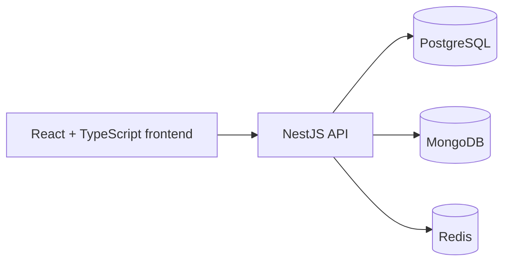

# MyBusiness

A configurable business platform that adapts to how a company actually operates. One codebase, three modes:

- **Services:** for businesses that sell services, not products
- **B2B catalog:** for businesses that sell products to other businesses
- **E-commerce:** a full online store

> **Status: in active development.** The Express backend is the stable reference implementation. I'm rebuilding the backend as a modular NestJS service with a new data architecture. 


## Why I built it


## Why I built it

Every business needs a website, but their needs differ: some sell services, some sell
products to other businesses, and some run a full online store. I wanted one platform
that can be reshaped to fit any of them instead of rebuilding the same app each time. Especially if their business needs change.

I'm building it with real use cases in mind: my family's business and my friends'
businesses.


## Architecture

MyBusiness started as a MERN app. After studying system design, I'm redesigning the backend around the shape of the data instead of the default stack:

| Store | Used for | Why |
| --- | --- | --- |
| **PostgreSQL** (via Prisma) | [user, companies, products, services orders, suppliers, jobs, ...] | Relational data that needs joins, constraints, and transactions |
| **MongoDB** | [websiteStyles, companyInfo, analytics, logs ...] | Flexible, document-shaped data that differs between business types |
| **Redis** | [sessions, caching, ...] | Fast, short-lived data |

The Express backend is being replaced by a NestJS backend organized into feature modules (controllers, services, dependency injection). The migration is meant to preserve existing API paths and response contracts, and the Express version stays in place until the new one reaches parity.



### How the modes work

A business runs in one of three modes: services, B2B catalog, or e-commerce. The mode
is switched from the admin section, and only a logged-in superadmin can change it.

Switching modes changes [which pages and features are available, e.g. checkout is
enabled in e-commerce mode but replaced by quote requests in B2B mode].

## Tech stack

React, TypeScript, Vite, Node.js, NestJS, Express (legacy), PostgreSQL, Prisma, MongoDB, Mongoose, Redis, Docker

## Project structure

| Folder | Purpose |
| --- | --- |
| `frontend/` | React, TypeScript, and Vite application |
| `backend/` | **Legacy backend.** The original Express and TypeScript implementation |
| `backend_nest/` | **New backend.** The NestJS migration, still in development |

The two backends are separate projects: changes to one do not apply to the other. The root Docker Compose configuration builds and runs `backend_nest/`, not the legacy backend.

## Getting started

<details>
<summary><strong>Prerequisites</strong></summary>

- Node.js and npm
- MongoDB and Redis for local backend development
- Docker Desktop, if using Docker Compose

</details>

<details>
<summary><strong>NestJS backend (new, in development)</strong></summary>

```powershell
cd backend_nest
npm install
Copy-Item .env.example .env
```

Set the required values in `backend_nest/.env`, including a strong `SESSION_SECRET` and valid database connection details. Then start the server:

```powershell
npm run start:dev
```

The default port is `5000`, and the health endpoint is `http://localhost:5000/api/health`.

Useful commands, run from `backend_nest/`:

```powershell
npm run build
npm test
npm run test:e2e
npm run db:validate
```

</details>

<details>
<summary><strong>Frontend</strong></summary>

```powershell
cd frontend
npm install
```

Create `frontend/.env.local` and set `VITE_APP_BASE_URL` to the backend API base URL, for example `http://localhost:5000/api`. Set any other `VITE_*` values the frontend needs, such as `VITE_GOOGLE_CLIENT_ID`. Then run:

```powershell
npm run dev
```

Vite serves the frontend at `http://localhost:5173` by default.

</details>

<details>
<summary><strong>Legacy Express backend</strong></summary>

```powershell
cd backend
npm install
npm run server
```

The Express server reads its configuration from environment variables (loaded from `.env`); configure its port, session secret, database connection, and other required service credentials before starting it. Its API routes are mounted under `/api`.

</details>

<details>
<summary><strong>Docker Compose</strong></summary>

Configure `backend_nest/.env` first. Compose builds the NestJS backend, the frontend, MongoDB, and Redis:

```powershell
docker compose up --build
```

The Compose file publishes the frontend on `http://localhost:3000`, MongoDB on port `27017`, Redis on port `6380`, and the backend on port `7000`. Because the Compose backend port mapping expects the NestJS process to listen on `7000`, set `PORT=7000` in `backend_nest/.env` when using Compose. Outside Compose, the NestJS default is `5000`.

Stop the containers with:

```powershell
docker compose down
```

</details>

## Notes

- Do not commit `.env` files or real credentials.
- The frontend's API URL is set with `VITE_APP_BASE_URL`; make sure it points to the backend you are running.